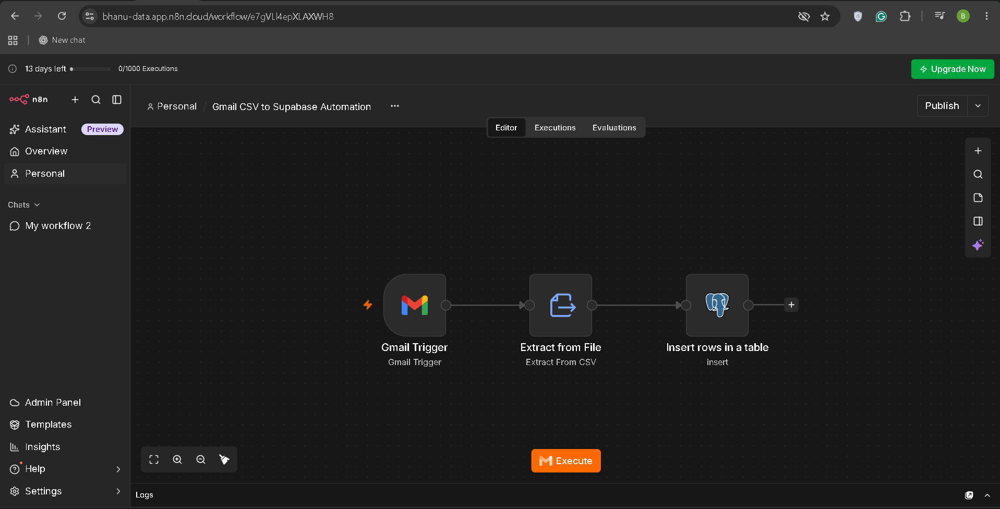
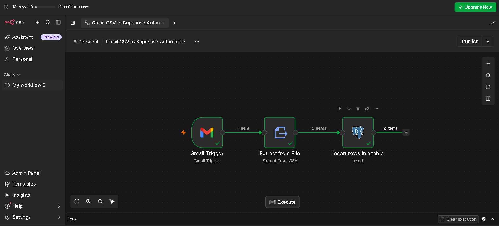
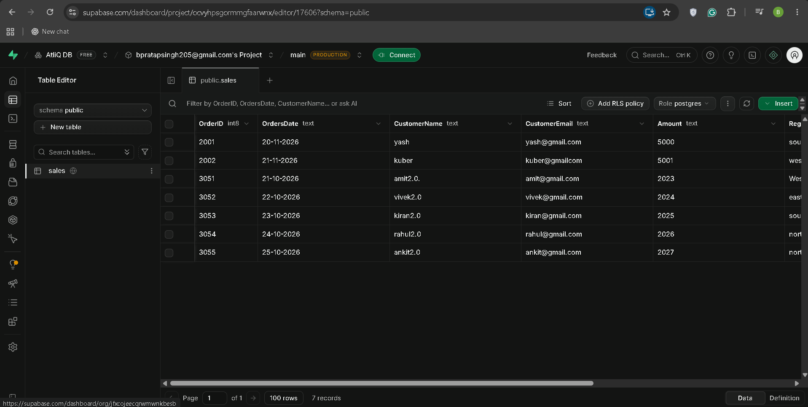

# Gmail CSV to Supabase Automation

An automated data ingestion workflow built with n8n that reads sales data from CSV email attachments and inserts the records into a PostgreSQL database hosted on Supabase.

## Project Overview

Businesses often receive structured data through email attachments. Manually downloading CSV files and importing their contents into a database can be repetitive and time-consuming.

This project automates the ingestion process by connecting Gmail, n8n, and Supabase.

When a matching email is received, the workflow extracts the CSV data and inserts the resulting records into the `sales` table in Supabase.

## Objectives

- Automate CSV data ingestion from email attachments.
- Reduce repetitive manual data entry.
- Transfer structured sales records into PostgreSQL.
- Demonstrate a practical workflow integrating email, data extraction, and a cloud database.

## Workflow Architecture

Gmail Trigger → Extract from File (CSV) → PostgreSQL Insert → Supabase

### Workflow Steps

1. **Gmail Trigger**
   - Detects incoming emails according to the configured trigger conditions.
   - Retrieves the email and its CSV attachment.

2. **Extract from File**
   - Reads the CSV attachment.
   - Converts the CSV data into structured records.

3. **PostgreSQL Insert**
   - Sends the extracted records to the configured PostgreSQL database.
   - Inserts the records into the target table.

4. **Supabase Database**
   - Stores the imported sales records in the `public.sales` table.

## Technology Stack

- **n8n:** Workflow automation and orchestration.
- **Gmail:** Email trigger and CSV attachment source.
- **CSV:** Source data format.
- **PostgreSQL:** Relational database.
- **Supabase:** Hosted PostgreSQL database platform.

## Database Schema

The workflow uses a `sales` table with the following columns:

| Column | Purpose |
|---|---|
| OrderID | Unique identifier for a sales order |
| OrderDate | Date of the order |
| CustomerName | Customer name |
| CustomerEmail | Customer email address |
| Amount | Sales amount |
| Region | Sales region |
| Status | Order status |

The actual column names and data types should match the table configured in Supabase.

## Screenshots

### 1. Workflow Overview

### 2. Successful Execution

### 3. Supabase Database Results

## Setup and Configuration

### Prerequisites

- An n8n instance.
- A Gmail account connected to n8n.
- A Supabase project.
- A PostgreSQL table configured to receive the CSV data.

### Configuration Steps

1. Create a Supabase project and configure the `sales` table.
2. Connect Gmail to n8n using the appropriate Gmail credentials.
3. Configure the Gmail Trigger to detect the intended emails.
4. Configure Extract from File to read the CSV attachment.
5. Connect the PostgreSQL node to the Supabase database.
6. Select the target schema and `sales` table.
7. Map the extracted fields to the corresponding database columns.
8. Test the workflow with a sample CSV attachment.
9. Verify that the records appear correctly in Supabase.

Credential configuration must be completed separately in the user's own n8n instance.

## Testing

The workflow was tested with CSV attachments containing sales records.

The validation process included:

- Confirming that Gmail detected the test email.
- Checking that the CSV attachment was parsed.
- Verifying successful execution of the PostgreSQL node.
- Confirming that the expected records appeared in Supabase.

## Limitations and Future Improvements

Potential enhancements include:

- Filtering out empty or invalid CSV rows.
- Adding data validation before database insertion.
- Implementing duplicate handling and idempotent processing.
- Adding error handling and failure notifications.
- Logging processed emails and imported records.
- Supporting additional CSV formats and data sources.

These are potential improvements and should not be considered implemented unless added to the workflow.

## Security

- Credentials must be configured locally in n8n.
- Database passwords, API keys, and access tokens must never be committed to GitHub.
- Use fictional or anonymized data in screenshots and sample files.
- Avoid publishing private customer information.
- Use secure database connection settings in production.

## Learning Outcomes

This project demonstrates practical experience with:

- Workflow automation using n8n.
- Email-triggered data ingestion.
- CSV parsing and structured data handling.
- PostgreSQL database integration.
- Cloud database usage with Supabase.
- Testing and validating an automated data pipeline.

## Author

Created as a hands-on automation project to demonstrate data ingestion and workflow integration skills.
